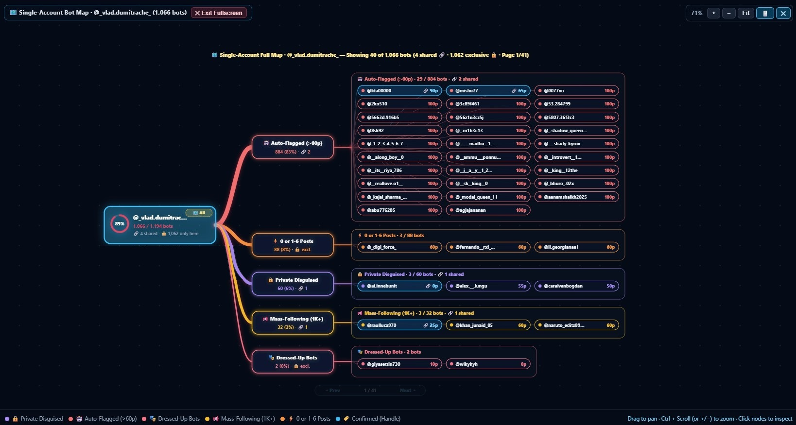
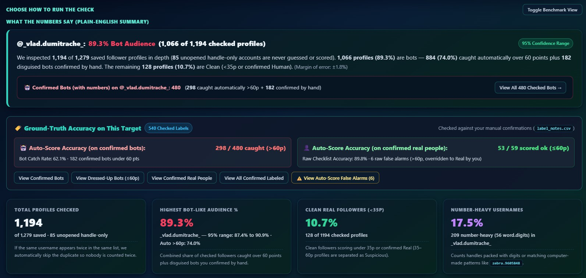
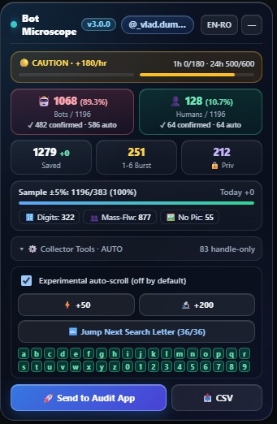

# Bot Microscope (`bot-microscope`)

> **100% Real-Data Instagram Audience Forensics & Bot Disclosure Engine (`v3.0.0`)**  
> Transparent, local-first Instagram follower auditing that separates real humans from automated bot farms and shared bot networks — with zero fabricated numbers (`Rule R-NOFAKE`), zero remote scraping servers, and honest 95% Wilson confidence bounds.

---

## Why Bot Microscope?

Most online "fake follower checkers" act like black boxes: type a username, wait five seconds, and read an unprovable percentage without seeing which accounts were inspected or why.

**Bot Microscope operates like a forensic microscope on your own computer:**
* **Start Clean + Bundled Real Bot-Farm Example**: All *personal* checkpoints and label databases stay strictly local and gitignored in `data/`, while a single verified public case study — [**`@_vlad.dumitrache_`**](https://www.instagram.com/_vlad.dumitrache_/) — ships in [`data/examples/`](./data/examples/) so fresh clones open immediately with a real bot-farm audit.
* **Rule `R-NOFAKE` (Zero Assumed Numbers)**: Unopened followers keep `null` metrics and are never scored or padded with defaults.
* **Mathematically Defensible 3-Tier Partition**: **`Bots (>60p or Confirmed)` + `Suspicious (35–60p)` + `Clean (0–34p)` = 100%** of checked followers, with 95% Wilson score confidence intervals.
* **Human-Paced & Account-Safe**: Pairs a passive Manifest V3 browser extension ([`browser-extension/`](./browser-extension/)) with a multi-threaded local Python dashboard (`http://127.0.0.1:8000`).

---

## Visual Preview

Real screenshots captured directly from the bundled **`@_vlad.dumitrache_`** bot-farm case study:

### 1. Single-Account Bot Connection Mindmap (`@_vlad.dumitrache_`)


### 2. Executive Summary, Ground-Truth & 4 KPI Cards


### 3. Live Browser Extension HUD (`v3.0.0`)
<p align="center">
  
</p>

---

## Key Features (`v3.0.0`)

1. **12-Signal Scoring + Two-Independent-Witnesses Cap (`60p`)**
   * Evaluates public profile traits: missing avatar (`+20p`), `0` posts (`+25p`, + `+15p` blank-shell bonus) or `1–6` same-day setup burst (`+15p`), empty/minimal bio `<=4 chars` (`+10p`), follow-exchange `5K+/5K+` ring (`+20p`), split handle forensics (`digit_heavy_username +20p` vs. mutually exclusive `stitched_username +10p`), and follow-ratio imbalance signals capped together at **`60p`** so no single ratio pattern can accuse an account without an independent witness.
   * **Private Accounts Audited Fairly**: Private profiles are still scored using visible header stats (`posts`, `followers`, `following`, `bio_length`, avatar, handle).
   * **Human Override Precedence**: Confirmed manual verdicts (`Bot`, `Human`, `Unsure`) always take precedence, and any conflict resolves safely to `Human`.

2. **Fast Browser Extension HUD & `<220ms` Mark + Close** ([Detailed Extension Guide](./browser-extension/README.md))
   * **Target Account Switcher**: Auto-locks clicked followers to the target list and lets you switch audited pages seamlessly from the HUD or popup (`🎯 Audit @current`).
   * **Inline Followers Modal Confirmation**: Tag `🤖` Bot / `👤` Real directly on `UNSURE` rows inside Instagram's Followers modal, or inspect open profile tabs with Bento metrics, ratio pills, 3-photo strip, and `B` / `H` / `U` keyboard shortcuts (`<220ms` auto-close while the Service Worker persists in the background).
   * **Rate-Limit Safety Speedometer**: Tracks `1h` (`180/hr` cap) and `24h` (`600/24h` cap) inspection cadence with automatic HTTP `429` cooldown protection.

3. **Bot Connection Mindmap & Single-Account Bot Map** ([`index.html`](./index.html))
   * **Cross-Account Network (`Bot Web` / `Flow Tree` / `Matrix & Directory`)**: Discovers exact shared `@bot` handles bridging multiple audited accounts, grouped by bridge hubs and bot archetypes, with Fullscreen stage mode and SVG / PNG / CSV export.
   * **Single-Account Full Bot Map**: Inspect *all* bots (`shared` + `exclusive`) belonging to any single audited account via the toolbar account selector (`#mmAccountScopeSelect`) or account card `🗺️ All` button.

4. **4-Worker Local Backend & Live Sync** ([`src/botaudit/workers.py`](./src/botaudit/workers.py))
   * **MemoryBankWorker**, **GroundTruthSyncWorker**, **AuditPrecomputeWorker**, and **LivePulseTracker** keep in-RAM caches, CSV ground-truth files, history breakdowns, and `index.html` status pulses synchronized across browser tabs without blocking HTTP requests.

---

## Quick Start

### 1. Requirements
* **Python**: `3.10+`
* **Browser**: Google Chrome, Microsoft Edge, or Brave (Chromium Manifest V3)
* **Node.js** *(optional)*: for running extension JavaScript syntax & contract tests

### 2. Setup Virtual Environment
```bash
git clone https://github.com/cipristefancu/bot-microscope.git
cd bot-microscope

python -m venv .venv

# Windows PowerShell:
.\.venv\Scripts\Activate.ps1
# Windows cmd.exe:
.\.venv\Scripts\activate.bat
# macOS / Linux:
source .venv/bin/activate

pip install -r requirements.txt
```

### 3. Launch the Interactive Web App (`http://127.0.0.1:8000`)
```bash
python app.py
```
Open [**`http://127.0.0.1:8000`**](http://127.0.0.1:8000) in your browser. On a fresh clone with no personal checkpoints yet, the dashboard automatically loads the bundled **Starter Bot-Farm Example (`@_vlad.dumitrache_`)** so you can explore real bot-farm signals right away — or inspect your own Instagram account via the extension.

### 4. Bundled Real Bot-Farm Starter Example (`@_vlad.dumitrache_`)
To give researchers and new users a concrete, 100% real-data starting case without inventing synthetic accounts, the repository includes observed public metrics from [`https://www.instagram.com/_vlad.dumitrache_/`](https://www.instagram.com/_vlad.dumitrache_/):
* [**`data/examples/_vlad.dumitrache_.json`**](./data/examples/_vlad.dumitrache_.json) — `1,279` saved real observed follower captures (`1,194` scored, pure automated Rule `R-NOFAKE` baseline: **`74.5%` Bots `>60p`** / `890` auto-bots, `11.6%` Suspicious `35–60p` review queue / `138` profiles, `13.9%` Clean / `166` profiles; zero pre-baked manual labels so you can practice tagging `Bot` / `Real` yourself).
* [**`data/examples/_vlad.dumitrache_.csv`**](./data/examples/_vlad.dumitrache_.csv) — `550` complete 9-column profile rows ready for CLI reporting or CSV upload:
  ```bash
  python run_audit.py --input data/examples/_vlad.dumitrache_.csv --output output/example_report.html --lang en
  ```

### 4. Load the Chrome / Edge Extension
1. Open `chrome://extensions` (or `edge://extensions`).
2. Turn ON **Developer mode** (top right).
3. Click **Load unpacked** and select [`browser-extension/`](./browser-extension/).
4. Pin **Bot Microscope Collector**, open Instagram, and audit your first target account — see [**`browser-extension/README.md`**](./browser-extension/README.md) for the complete extension workflow.

### 5. Offline CLI HTML Report (Optional)
Generate a self-contained bilingual HTML report from any 9-column CSV (`data/template.csv` shows the exact header):
```bash
python run_audit.py --input path/to/followers.csv --output output/report.html --lang en
```

---

## Documentation
* [**`browser-extension/README.md`**](./browser-extension/README.md) — Complete extension architecture, permissions, shortcuts, speedometer, multi-tab sync & troubleshooting.
* [**`DOCUMENTATION.md`**](./DOCUMENTATION.md) — End-to-end user & developer manual (workflow, dashboard sections, Mindmap, 100-point rubric, local file layout).
* [**`docs/instagram-payload-schema.md`**](./docs/instagram-payload-schema.md) — Captured Instagram GraphQL/REST payload schema reference.

---

## Project Structure

```text
bot-microscope/
├── app.py                        # Local WSGI web server entry point (http://127.0.0.1:8000)
├── run_audit.py                  # Offline CLI CSV -> self-contained HTML report generator
├── run_evaluation.py             # Split-aware empirical accuracy evaluation CLI
├── config.yaml                   # Heuristic weights, thresholds & sample confidence settings
├── index.html                    # Interactive glassmorphic dashboard + Bot Connection Mindmap (EN | RO)
├── browser-extension/            # Chrome / Edge / Brave Manifest V3 Extension (v3.0.0)
│   ├── README.md                 # Dedicated Extension Guide
│   ├── manifest.json             # Permissions & content-script wiring
│   ├── background.js             # MV3 Service Worker & <220ms fast tab close persistence
│   ├── content.js / content.css  # Followers badges, inline confirms, Bento HUD & shortcuts
│   ├── injected-interceptor.js   # Passive read-only MAIN-world fetch/XHR clone
│   ├── parser.js                 # Rule R-NOFAKE parser, 12-signal scorer & CSV exporter
│   └── popup.html / popup.js     # Toolbar popup & Target Account Switcher
├── data/
│   ├── examples/                 # Bundled real bot-farm starter case (@_vlad.dumitrache_) & previews
│   │   ├── _vlad.dumitrache_.json
│   │   ├── _vlad.dumitrache_.csv
│   │   ├── example_vlad_dumitrache_mindmap.jpg
│   │   ├── example_vlad_dumitrache_dashboard.jpg
│   │   └── example_hud_v3.jpg
│   └── template.csv              # Clean 9-column CSV header template (all personal data is gitignored)
├── docs/
│   └── instagram-payload-schema.md
├── src/botaudit/
│   ├── web.py                    # ThreadedWSGIServer, REST API, Mindmap builder & extended scoring
│   ├── workers.py                # Debounced 4-Worker background engine
│   ├── scoring.py                # Baseline & ratio-helper scoring functions
│   ├── stats.py                  # Wilson score 95% confidence intervals & rankings
│   ├── labels.py                 # Ground-truth CSV/note synchronization & backups
│   ├── capture.py                # Capture scrubbing, merging & cross-checkpoint dedup
│   ├── handles.py                # Username normalization & digit/stitched forensics
│   ├── evaluate.py / metrics.py  # Out-of-sample evaluation & confusion metrics
│   ├── loader.py / config.py     # Strict CSV & YAML validation
│   └── report.py + templates/    # Bilingual Jinja2 HTML report + Matplotlib PNG charts
└── tests/                        # Offline unit, WSGI, Mindmap, guardrail & Node JS contract tests
```

---

## Testing & Guardrails

```bash
# Run full test suite (runs cleanly on a zero-data fresh clone)
pytest -q

# Verify browser extension JS contracts directly
node tests/js/hud_inspector_contract.js
node tests/js/background_contract.js

# Linter check
ruff check .
```

* **Zero Scraping Libraries ([`tests/test_guardrails.py`](./tests/test_guardrails.py))**: Verifies banned scraping tools (`selenium`, `playwright`, `requests`, `urllib.request`, `instaloader`, etc.) are never imported in `src/botaudit/`.
* **Zero Synthetic Data ([`tests/test_zero_synthetic_data.py`](./tests/test_zero_synthetic_data.py))**: Guarantees no fabricated/placeholder profile values exist anywhere in the codebase or dashboard.

---

## License

Released under the [**MIT License**](./LICENSE). Intended for transparent audience verification and educational/research analysis in accordance with applicable platform terms.

---

Made with love by [freestate.ro](https://freestate.ro)
